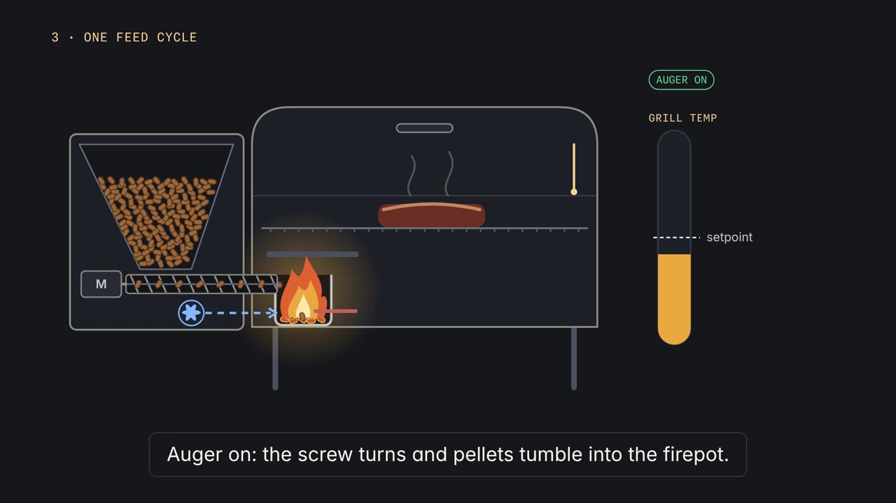
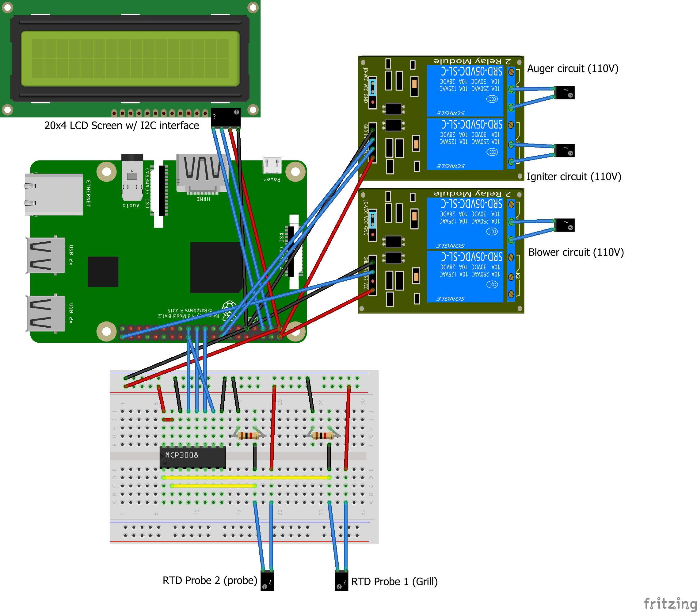

# Inferno
Wood pellet smoker powered by .NET 8 and Raspberry Pi 3.

* See the [photo album](https://1drv.ms/u/s!Ag9fVAifJI6dsrwlhf-iGDwD4qkaxw?e=BbMc6f)!
* See it [featured on an episode of On .NET](https://www.youtube.com/watch?v=4kJGRuXZ4kg)! This is a short overview and discussion.
* See me [demo the smoker on the stream I co-host, The DotNet Docs](https://www.youtube.com/watch?v=Ps3bHwY8dSg)! This is a more in-depth review of some of the code along with a live demo.

## How it feeds the fire

A 2½-minute animated explainer (click the image to watch). It covers how the auger feeds pellets to the fire, the factory Traeger controller's fixed on/off cycles, and the PID loop Inferno uses in Hold mode.

## Inferno.Api

This is the core functionality. It exposes all functionality as a web API. I run it on http://localhost:5000 and control it via a variety of tools. The PID algorithm, fire minder, and display logic all reside here.

## Inferno.Cli

A command-line interface for the API.

## Inferno.Common

Class library shared between projects.

## Inferno.Mqtt

Service that polls Inferno.Api, relaying commands and statuses to/from an MQTT broker. I surface this in a Home Assistant dashboard for UI.

## Inferno.Deploy

Pulumi infrastructure-as-code project for deploying to the Pi.

## Inferno.Tests

xUnit test project for core logic (PID, RTD, fire monitoring, preheat detection, etc.).

## Hardware

The grill itself is a Traeger Junior Elite 20. The custom hardware is comprised of a Raspberry Pi 3, some relays for controlling the 110V circuits, a 20x4 LCD display, a MCP3008 analog to digital converter.
 

